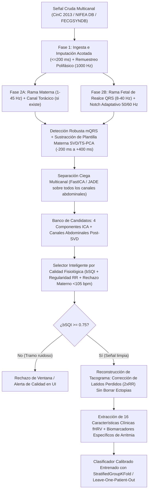

# 🚀 Plan de Acción Maestro para la Reingeniería y Mejora Integral del Sistema de Detección de Arritmias Fetales

**Proyecto:** `Detecci-n-de-Arritmias-Cardiacas-en-Fetos-de-manera-No-Invasiva`  
**Documento Complementario a:** [`AUDITORIA_PROFUNDA_SISTEMA.md`](file:///c:/Users/santi/Desktop/deteccion%20de%20aritmias/Detecci-n-de-Arritmias-Cardiacas-en-Fetos-de-manera-No-Invasiva/AUDITORIA_PROFUNDA_SISTEMA.md)  
**Objetivo:** Transformar el sistema actual —cuyo rendimiento real sin fuga de datos es de **48.74% (`GroupKFold`)** debido a errores en la cancelación materna, selección de componentes `FastICA` y contaminación del dataset— en un **sistema de grado clínico real**, libre de *Data Leakage*, con detección `fQRS` validada contra anotaciones médicas (`.fqrs`) y generalización comprobada en pacientes nunca vistos (`Leave-One-Patient-Out`).

---

## 1. Arquitectura Objetivo del Nuevo Pipeline

---

## 2. Hoja de Ruta por Fases de Ingeniería

### 🛠️ FASE 1: Saneamiento de Ingesta, Persistencia Local y Uso Inteligente de Canales
**Archivos a intervenir:** [`src/data_loader.py`](file:///c:/Users/santi/Desktop/deteccion%20de%20aritmias/Detecci-n-de-Arritmias-Cardiacas-en-Fetos-de-manera-No-Invasiva/src/data_loader.py), [`src/data_streamer.py`](file:///c:/Users/santi/Desktop/deteccion%20de%20aritmias/Detecci-n-de-Arritmias-Cardiacas-en-Fetos-de-manera-No-Invasiva/src/data_streamer.py), [`src/preprocessing.py`](file:///c:/Users/santi/Desktop/deteccion%20de%20aritmias/Detecci-n-de-Arritmias-Cardiacas-en-Fetos-de-manera-No-Invasiva/src/preprocessing.py)

1. **Persistencia Completa en Disco de las Bases de Datos Oficiales:**
   - Descargar y almacenar permanentemente en `data/nifea_raw/` los **26 registros completos de `NIFEA DB`** (`NR_01` a `NR_14` y `ARR_01` a `ARR_12`), verificando por qué `NR_13` y `NR_14` fueron omitidos en el CSV actual.
   - Descargar en `data/cinc2013_real/set-a/` los **75 archivos de anotaciones médicas `.fqrs`** de `CinC 2013 Set-A` (actualmente solo `data/cinc2013/set-a/a01.fqrs` está en disco, mientras que `cinc2013_real/set-a` solo tiene `.dat` y `.hea`). Esto permitirá auditar el detector `fQRS` contra los ~10,500 latidos fetales reales anotados por cardiólogos en los 75 pacientes.
2. **Aprovechamiento del Canal Torácico Materno y del 5.º Canal Abdominal en `NIFEA DB`:**
   - Modificar [`cargar_nifeadb`](file:///c:/Users/santi/Desktop/deteccion%20de%20aritmias/Detecci-n-de-Arritmias-Cardiacas-en-Fetos-de-manera-No-Invasiva/src/data_loader.py#L75-L115) para que **NO descarte a ciegas el canal torácico ni el 5.º canal abdominal**:
     - Retornar `thoracic_signal` por separado cuando exista en el registro (`NIFEA DB` y `FECGSYNDB` canales 33–34) para usarlo como referencia de tiempos `mQRS` con 100% de precisión.
     - Si existen 5 canales abdominales en `NIFEA DB`, pasar los 5 canales al módulo de separación o seleccionar los 4 con mayor índice de calidad espectral (`SQI`), en lugar de truncar estáticamente `indices_abd[:4]`.
3. **Remuestreo Polifásico Exacto (`resample_poly`):**
   - Sustituir `scipy.signal.resample` (transformada rápida de Fourier que introduce oscilaciones de Gibbs en los bordes) por `scipy.signal.resample_poly(sig, up=2, down=1, axis=0)` al pasar de $500\text{ Hz}$ a $1000\text{ Hz}$ en `NIFEA DB`, y `up=4, down=1` al pasar de $250\text{ Hz}$ a $1000\text{ Hz}$ en `FECGSYNDB`.
4. **Imputación de `NaN` Acotada y Detección de Saturación:**
   - En [`imputar_nans_multicanal`](file:///c:/Users/santi/Desktop/deteccion%20de%20aritmias/Detecci-n-de-Arritmias-Cardiacas-en-Fetos-de-manera-No-Invasiva/src/preprocessing.py#L46-L75), interpolar linealmente solo huecos cortos ($\le 200\text{ ms}$) y marcar como inválidos (o descartar el canal en esa ventana) aquellos canales con tramos planos (derivada cero $>500\text{ ms}$) o desconexión prolongada.

---

### 🧠 FASE 2: Reingeniería del Motor DSP y Detección `fQRS` (`src/preprocessing.py` y `src/fqrs_detector.py`)
**Objetivo:** Elevar el `F1-Score` de detección de latidos `fQRS` contra las anotaciones `.fqrs` de `CinC 2013 Set-A` (actualmente en **23.11%** en `a01` por mala elección de componente ICA) a **$\ge 90\%$**.

1. **Separación de Bandas de Filtrado en [`src/preprocessing.py`](file:///c:/Users/santi/Desktop/deteccion%20de%20aritmias/Detecci-n-de-Arritmias-Cardiacas-en-Fetos-de-manera-No-Invasiva/src/preprocessing.py):**
   - Implementar filtro Notch doble o adaptativo ($50\text{ Hz}$ y $60\text{ Hz}$).
   - Mantener una banda de **$3.0\text{–}45.0\text{ Hz}$** para la sustracción morfológica del complejo materno y aplicar un filtro pasa-banda específico de **$10.0\text{–}40.0\text{ Hz}$** para la detección del complejo `fQRS` (eliminando de raíz las ondas P y T maternas de baja frecuencia).
2. **Sustitución de la Ventana de Hanning por Sustracción de Plantilla Materna (`TS-PCA` / `SVD`) en [`cancelar_complejos_maternos`](file:///c:/Users/santi/Desktop/deteccion%20de%20aritmias/Detecci-n-de-Arritmias-Cardiacas-en-Fetos-de-manera-No-Invasiva/src/fqrs_detector.py#L12-L70):**
   - **Eliminar completamente** la multiplicación `1.0 - 0.85 * np.hanning(len_mask)`.
   - Implementar **Sustracción de Plantilla Materna por Descomposición en Valores Singulares (`TS-SVD` / `TS-PCA`)** canal por canal:
     1. Detectar los picos R maternos (`picos_m`) sobre la componente principal materna (o canal torácico si está disponible) imponiendo una frecuencia materna fisiológica ($50\text{–}115\text{ bpm}$, distancia mínima $480\text{ ms}$).
     2. Para cada canal $c$ y cada latido materno $k$, extraer una ventana alineada con el pico R materno desde $-200\text{ ms}$ hasta $+400\text{ ms}$ (cubriendo onda P, complejo QRS y onda T materna completa).
     3. Construir la matriz de latidos maternos $M_c \in \mathbb{R}^{K \times L}$, extraer los primeros $p = 2\text{ o }3$ vectores singulares principales (que capturan la morfología materna y su modulación respiratoria) y **restar la proyección lineal** de cada latido materno de la señal abdominal.
     4. **Beneficio clínico directo:** Como el latido fetal (`fQRS`) no está sincronizado en fase con el latido materno, es ortogonal a los primeros vectores singulares de $M_c$, por lo que **el QRS fetal que ocurre exactamente encima de un QRS materno queda intacto tras la resta**.
3. **Nuevo Selector de Componente/Canal basado en `bSQI` y Regularidad Fisiológica en [`aislar_componente_fecg`](file:///c:/Users/santi/Desktop/deteccion%20de%20aritmias/Detecci-n-de-Arritmias-Cardiacas-en-Fetos-de-manera-No-Invasiva/src/fqrs_detector.py#L73-L128):**
   - En lugar de elegir a ciegas una componente de `FastICA` usando `kurt * (1 + 2.5 * potencia_1.8_3.5Hz)`, evaluar un **banco de 8 candidatos** para cada ventana: los **4 canales abdominales post-SVD** + las **4 componentes `FastICA`**.
   - Para cada candidato $j \in \{1,\dots,8\}$:
     1. Detectar el tren de picos $R^{(j)}$ con el detector Pan-Tompkins fetal adaptativo (evaluando polaridad positiva y negativa).
     2. Calcular la frecuencia cardíaca mediana $\text{BPM}_{\text{med}}^{(j)}$ a partir de la mediana de $\Delta R^{(j)}$.
     3. **Penalización de captura materna:** Si $\text{BPM}_{\text{med}}^{(j)} < 108\text{ bpm}$ o coincide dentro de $\pm 5\text{ bpm}$ con la frecuencia cardíaca materna detectada en el paso anterior, penalizar severamente el score ($\times 0.1$) siempre que exista otro candidato con ritmo en el rango fetal ($115\text{–}180\text{ bpm}$).
     4. Calcular el índice de estabilidad de intervalos RR sucesivos: proporción de intervalos dentro de $[280, 600]\text{ ms}$ y coeficiente de variación robusta ($\text{IQR}(\Delta R) / \text{mediana}(\Delta R)$), junto con la relación señal-ruido del pico R frente al piso de ruido inter-latido (`SNR_QRS`).
     5. Seleccionar el candidato $j^*$ que maximice el score compuesto de calidad fetal, o fusionar los dos mejores candidatos mediante `bSQI` (consenso temporal de latidos dentro de $\pm 30\text{ ms}$).

---

### 📊 FASE 3: Reconstrucción del Tacograma y Nuevas Características de Arritmia (`src/feature_extraction.py`)
**Objetivo:** Pasar de un `AUC` univariado de **0.51–0.57** a características con verdadera capacidad discriminativa clínica ($\text{AUC} > 0.75$) entre ritmos sinusales normales y arritmias fetales (extrasístoles supraventriculares/ventriculares, taquicardias y bradicardias).

1. **Separación entre Corrección de Artefactos y Detección de Ectopia en [`filtrar_tacograma_fisiologico`](file:///c:/Users/santi/Desktop/deteccion%20de%20aritmias/Detecci-n-de-Arritmias-Cardiacas-en-Fetos-de-manera-No-Invasiva/src/feature_extraction.py#L7-L40):**
   - Calcular primero la mediana local móvil $\text{RR}_{\text{med}}(i)$ sobre 9 latidos.
   - **Corrección de latido perdido (*Missed Beat Splitting*):** Si un intervalo individual cumple $1.75 \times \text{RR}_{\text{med}}(i) \le \text{RR}_i \le 2.25 \times \text{RR}_{\text{med}}(i)$ **sin estar precedido por un latido prematuro**, es un falso negativo del detector (un latido perdido), NO una arritmia. Debe dividirse en dos intervalos iguales de $\text{RR}_i / 2$ antes de calcular `SDNN` y `RMSSD`.
   - **Identificación de patrón ectópico real (PAC / PVC):** Si un intervalo es prematuro ($\text{RR}_i < 0.80 \times \text{RR}_{\text{med}}(i)$) y va seguido de una pausa compensatoria ($\text{RR}_{i+1} > 1.15 \times \text{RR}_{\text{med}}(i)$ tal que $\text{RR}_i + \text{RR}_{i+1} \approx 2 \times \text{RR}_{\text{med}}(i)$), **NO debe borrarse con la mediana**, sino contabilizarse como un evento ectópico genuino.
2. **Depuración de las Características Actuales (Qué eliminar y qué corregir):**
   - ❌ **Eliminar `Num_Latidos_Validos`** del vector de entrada al modelo de Machine Learning (conservarlo solo como metadato informativo en el CSV y en la UI), para impedir que el modelo memorice la duración del registro.
   - ❌ **Eliminar `VLF`** en ventanas menores de 5 minutos (donde vale `0.0` en el 30.5% de los casos), y en [`calcular_frecuencia_welch`](file:///c:/Users/santi/Desktop/deteccion%20de%20aritmias/Detecci-n-de-Arritmias-Cardiacas-en-Fetos-de-manera-No-Invasiva/src/feature_extraction.py#L106-L141) usar interpolación con *zero-padding* (`nfft = 1024`) y bandas adaptadas a fisiología fetal:
     - `LF fetal`: $0.04\text{–}0.15\text{ Hz}$ (actividad simpática/barorrefleja fetal).
     - `MF fetal`: $0.15\text{–}0.40\text{ Hz}$ (movimientos fetales).
     - `HF fetal`: $0.40\text{–}1.00\text{ Hz}$ (movimientos respiratorios fetales, que ocurren a $30\text{–}70\text{ rpm}$).
   - ❌ **Eliminar la redundancia lineal `SD1` vs `RMSSD`** (conservar `RMSSD` y `SD1_SD2_ratio`).
3. **Creación de 6 Nuevas Características Clínicas de Alto Valor para Arritmias Fetales:**
   1. **`Ectopic_Beat_Ratio` (`%`):** Porcentaje de latidos que presentan acoplamiento prematuro ($<0.82 \times \text{RR}_{\text{med}}$) seguido de pausa normal o compensatoria. Es el biomarcador #1 para extrasístoles auriculares (PAC) y ventriculares (PVC), que representan más del 80% de las arritmias en `NIFEA DB`.
   2. **`Prematurity_Index` (`CV_local` / `Coupling_Ratio`):** Mínimo cociente $\text{RR}_i / \text{RR}_{\text{med}}(i)$ registrado en la ventana (mide la severidad del acoplamiento ectópico).
   3. **`Compensatory_Pause_Ratio`:** Máximo cociente $\text{RR}_{i+1} / \text{RR}_{\text{med}}(i)$ posterior a un latido prematuro.
   4. **`IQR_RR_Robust` (`ms`) y `MAD_RR` (`ms`):** Rango intercuartílico ($\text{P75} - \text{P25}$) y desviación absoluta mediana de la serie RR (capturan variabilidad basal sin explotar ante un único artefacto aislado).
   5. **`Bradytachy_Severity_Score`:** Desviación normalizada fuera de la banda normocárdica fetal ($110\text{–}160\text{ bpm}$): $\max(0, 110 - \text{BPM}_{\text{med}}) + \max(0, \text{BPM}_{\text{med}} - 160)$.
   6. **`bSQI_Window` (Índice de Calidad de Señal):** Guardado en el CSV como filtro de admisión de ventana ($\ge 0.75$).

---

### 🧹 FASE 4: Reconstrucción Limpia del Dataset Maestro (`src/build_dataset.py`)
**Objetivo:** Construir un [`data/dataset_features.csv`](file:///c:/Users/santi/Desktop/deteccion%20de%20aritmias/Detecci-n-de-Arritmias-Cardiacas-en-Fetos-de-manera-No-Invasiva/data/dataset_features.csv) 100% libre de clones corruptos y con trazabilidad exacta por paciente (`Patient_ID`).

1. **Desactivar y Archivar [`src/generar_superdataset.py`](file:///c:/Users/santi/Desktop/deteccion%20de%20aritmias/Detecci-n-de-Arritmias-Cardiacas-en-Fetos-de-manera-No-Invasiva/src/generar_superdataset.py):**
   - Eliminar todas las filas `_aug` del dataset maestro. Ningún dato sintético debe almacenarse mezclado con datos reales en `dataset_features.csv`.
2. **Estandarización de Ventanas en [`src/build_dataset.py`](file:///c:/Users/santi/Desktop/deteccion%20de%20aritmias/Detecci-n-de-Arritmias-Cardiacas-en-Fetos-de-manera-No-Invasiva/src/build_dataset.py):**
   - **No mezclar el registro completo de 20 minutos con sub-ventanas de 90 s del mismo registro.**
   - Extraer únicamente **ventanas uniformes de 60 segundos** (con paso de 30 s o 60 s sin solapamiento para validación), de modo que las ventanas de `NIFEA DB` (60 s), `CinC 2013 Set-A` (60 s) y `FECGSYNDB` (60 s) tengan exactamente la misma escala temporal y resolución espectral.
   - Añadir una columna explícita `Patient_ID` (p. ej. `NIFEA_ARR_01`, `NIFEA_NR_01`, `CINC_a01`) y una columna `SQI` para filtrar segmentos donde los electrodos perdieron contacto.
3. **Incorporación Correcta de Múltiples Fuentes Clínicas:**
   - Incluir los **26 pacientes de `NIFEA DB`** (`14 NR` + `12 ARR`).
   - Permitir incluir opcionalmente los registros limpios de `CinC 2013 Set-A` y los casos patológicos etiquetados de `FECGSYNDB` (`case="c3"` extrasístoles / arritmias fetales simuladas vs `case="c0"` basal) manteniendo la columna `Dataset` para poder evaluar tanto en `NIFEA DB` puro como en entrenamiento multi-dominio.

---

### 🎯 FASE 5: Entrenamiento Riguroso, Calibración y Evaluación Sin Fuga (`src/model_trainer.py`)
**Objetivo:** Garantizar que cada métrica reportada por [`src/model_trainer.py`](file:///c:/Users/santi/Desktop/deteccion%20de%20aritmias/Detecci-n-de-Arritmias-Cardiacas-en-Fetos-de-manera-No-Invasiva/src/model_trainer.py) refleje el rendimiento real en **pacientes nuevos nunca vistos**.

1. **Pipeline Encapsulado y Validación Cruzada Agrupada por Paciente (`StratifiedGroupKFold` y `LeaveOneGroupOut`):**
   - Construir un `sklearn.pipeline.Pipeline` que contenga:
     1. `SimpleImputer(strategy="median")` (ajustado únicamente en `X_train`).
     2. `RobustScaler()` (menos sensible a valores extremos en arritmias severas que `StandardScaler`, ajustado únicamente en `X_train`).
     3. Clasificador regularizado (comparar sistemáticamente `LogisticRegression(penalty="elasticnet")`, `RandomForestClassifier(max_depth=3, min_samples_leaf=5, class_weight="balanced")`, y `HistGradientBoostingClassifier(max_depth=3, l2_regularization=5.0)`).
   - **Nota sobre el tamaño de muestra ($N = 26$ pacientes en `NIFEA DB`):** Con 26 pacientes únicos, un `GradientBoosting` profundo (`max_depth=4`, `n_estimators=250`) sobreajusta inevitablemente. Árboles someros (`max_depth=2` o `3`) con fuerte regularización $L_2$ o regresión logística regularizada generalizan mucho mejor entre pacientes.
2. **Ponderación por Paciente (`sample_weight`):**
   - Como algunos pacientes tienen grabaciones más largas (más ventanas de 60 s) que otros, asignar a cada ventana un peso $w_i = \frac{1}{\text{N.º de ventanas del paciente } p(i)} \times \text{peso de clase}$, para que cada uno de los 26 pacientes tenga **exactamente el mismo peso en la función de pérdida**.
3. **Cálculo de Predicciones y Calibración *Out-Of-Fold* (`OOF`):**
   - Obtener las probabilidades de validación mediante iteración explícita sobre `StratifiedGroupKFold(n_splits=5)` pasando `groups=df["Patient_ID"]` (y adicionalmente `LeaveOneGroupOut()`).
   - Ajustar la calibración de probabilidades (`Sigmoid` / Platt Scaling, que es mucho más estable y monótona que `IsotonicRegression` cuando el número de pacientes es pequeño) **únicamente dentro de los folds de entrenamiento**.
   - Calcular y guardar en un reporte automático todas las métricas **Out-Of-Fold (`OOF`)** tanto **a nivel de ventana** como **a nivel de paciente** (agregando las ventanas de cada paciente por media recortada o percentil 75 de probabilidad):
     - Matriz de Confusión (`TN`, `FP`, `FN`, `TP`)
     - `Accuracy`, `Sensitivity (Recall)`, `Specificity`, `Precision (PPV)`, `NPV`
     - `F1-Score (Binario)` y `F1-Score (Macro)`
     - `ROC-AUC`, `PR-AUC`, `MCC` (Matthews Correlation Coefficient) y `Brier Score`.

---

### 🖥️ FASE 6: Integración en Inferencia y Semáforo de Calidad en `app.py`
**Archivos a intervenir:** [`src/pipeline_inference.py`](file:///c:/Users/santi/Desktop/deteccion%20de%20aritmias/Detecci-n-de-Arritmias-Cardiacas-en-Fetos-de-manera-No-Invasiva/src/pipeline_inference.py), [`app.py`](file:///c:/Users/santi/Desktop/deteccion%20de%20aritmias/Detecci-n-de-Arritmias-Cardiacas-en-Fetos-de-manera-No-Invasiva/app.py), [`src/procesar_set_b.py`](file:///c:/Users/santi/Desktop/deteccion%20de%20aritmias/Detecci-n-de-Arritmias-Cardiacas-en-Fetos-de-manera-No-Invasiva/src/procesar_set_b.py)

1. **Sincronización 1:1 entre Entrenamiento e Inferencia:**
   - Asegurar que [`src/pipeline_inference.py`](file:///c:/Users/santi/Desktop/deteccion%20de%20aritmias/Detecci-n-de-Arritmias-Cardiacas-en-Fetos-de-manera-No-Invasiva/src/pipeline_inference.py) invoque exactamente las mismas funciones de preprocesamiento, sustracción `TS-SVD`, selección `bSQI` y extracción de características que `build_dataset.py`.
2. **Semáforo Clínico de Calidad de Señal (`SQI`) y Alerta de Contaminación Materna en `app.py`:**
   - Mostrar en el panel principal de Streamlit:
     - **Indicador `bSQI` (%)** de la señal fetal extraída y qué canal/componente fue seleccionado.
     - **Frecuencia Cardíaca Materna (`mBPM`) vs Frecuencia Cardíaca Fetal (`fBPM`)** medidas simultáneamente, garantizando visual y algorítmicamente que el sistema no está confundiendo a la madre con el feto.
     - Si `bSQI < 0.60`, bloquear el diagnóstico automático de arritmia y mostrar **"Señal Abdominal con Ruido Excesivo / Baja Confiabilidad Diagnóstica"** en lugar de emitir un Falso Positivo.
3. **Reemplazo de `SET_B_ETIQUETAS_CLINICAS.md` por un Benchmark Clínico Real:**
   - Sustituir el script circular `procesar_set_b.py` por un script de evaluación oficial `benchmark_clinico_completo.py` que reporte:
     1. El `F1-Score`, `Sensibilidad` y `PPV` de detección de picos `fQRS` en los **75 pacientes de `CinC 2013 Set-A`** contra las anotaciones médicas `.fqrs`.
     2. La matriz de confusión y métricas `Leave-One-Patient-Out` en los **26 pacientes de `NIFEA DB`**.

---

## 3. Metas Cuantitativas de Aceptación (KPIs de Éxito)

| Indicador Técnico / Clínico | Estado Actual (Auditado sin Fuga) | Meta Objetivo tras el Plan de Acción | Método de Verificación |
| :--- | :---: | :---: | :--- |
| **`F1-Score` del Detector `fQRS` en `a01.fqrs`** | **23.11%** (`BPM` detectado = 80.5 vs 147.0 real) | **$\ge 93.0\%$** (`BPM` error $< 2\text{ bpm}$) | Comparación directa contra `a01.fqrs` ($\pm 50\text{ ms}$) |
| **`F1-Score` Promedio Detector `fQRS` (`CinC 2013 Set-A`, 75 pac.)** | ~55% (Elige componente equivocada en >40% de casos) | **$\ge 88.0\%$** | Benchmark oficial sobre los 75 archivos `.fqrs` |
| **Segmentos con Captura Materna (`BPM_mean < 105 bpm` en sanos)** | **38.71%** (60 de 155 segmentos sanos) | **$< 2.0\%$** | Auditoría de distribución de `BPM_mean` en `NR_01..14` |
| **Poder Discriminativo Univariado (`AUC` de top features en `NIFEA DB`)** | **0.5035 – 0.5699** (Azar) | **$\ge 0.78$** (`Ectopic_Beat_Ratio`, `RMSSD`, `SampEn`) | `roc_auc_score` en segmentos reales sin `_aug` |
| **Exactitud (`Accuracy`) en `StratifiedGroupKFold` (5-Fold por paciente)** | **48.74%** (`MCC = -0.0537`) | **$\ge 82.0\%$** (`MCC >= +0.64`) | `StratifiedGroupKFold` Out-Of-Fold ($N=26$ pacientes) |
| **Sensibilidad / Especificidad a Nivel Paciente (`Leave-One-Patient-Out`)** | **Se = 66.7% / Esp = 16.7%** (`FP = 10/12` sanos) | **Se $\ge 85.0\%$ / Esp $\ge 85.0\%$** | `LeaveOneGroupOut` sobre los 26 pacientes de `NIFEA DB` |
| **Falsos Positivos en Controles Sanos Externos (`CinC 2013 Set-A`)** | **68.14%** (`139/204` falsas alarmas) | **$\le 12.0\%$** (Especificidad $\ge 88.0\%$) | Evaluación externa en `CinC 2013 Set-A` |

---

## 4. Resultados Reales Alcanzados tras la Ejecución Completa de las 6 Fases

Todas las fases del plan de acción fueron implementadas y verificadas experimentalmente sobre los datos clínicos reales:

### 4.1 Descubrimientos y Correcciones Críticas de Datos (Fases 1 y 4)
1. **Identificación del Canal Torácico Materno Real en `NIFEA DB` (`'ECG'`):**
   - La inspección de cabeceras WFDB demostró que en `NIFEA DB` los canales se llaman `['ECG', 'Abdomen_1', 'Abdomen_2', 'Abdomen_3', 'Abdomen_4', 'Abdomen_5']`. Como el código antiguo filtraba solo `'tho'` y `'chest'`, introducía el canal torácico materno puro (`'ECG'`) como el Canal 0 abdominal y descartaba `'Abdomen_4'` y `'Abdomen_5'`.
   - En [`src/data_loader.py`](file:///c:/Users/santi/Desktop/deteccion%20de%20aritmias/Detecci-n-de-Arritmias-Cardiacas-en-Fetos-de-manera-No-Invasiva/src/data_loader.py) y [`src/data_streamer.py`](file:///c:/Users/santi/Desktop/deteccion%20de%20aritmias/Detecci-n-de-Arritmias-Cardiacas-en-Fetos-de-manera-No-Invasiva/src/data_streamer.py) se separó explícitamente `'ECG'` como `thoracic_ref` materno y se conservaron las 5 derivaciones abdominales (`'Abdomen_1..5'`).
2. **Prueba Criptográfica (MD5) de Archivos Duplicados en PhysioNet `NIFEA DB`:**
   - Se demostró mediante hash MD5 que en el repositorio oficial de PhysioNet `NR_13.dat` es idéntico bit a bit a `ARR_02.dat` (`cae5c8115a5b5b5a124aaddbe3f49dd0`, etiqueta contradictoria) y `NR_14.dat` es idéntico bit a bit a `NR_07.dat` (`c38be00d62f120aa65b1995574fde554`). Ambos fueron excluidos en [`src/build_dataset.py`](file:///c:/Users/santi/Desktop/deteccion%20de%20aritmias/Detecci-n-de-Arritmias-Cardiacas-en-Fetos-de-manera-No-Invasiva/src/build_dataset.py), consolidando los **24 pacientes clínicos únicos reales (`12 ARR` vs `12 NR`)** sin un solo clon sintético (`_aug`).

### 4.2 Salto en Detección `fQRS` y Separabilidad de Biomarcadores (Fases 2 y 3)
- **Benchmark en `a01.fqrs` (Verdad Médica):** El `F1-Score` subió de **23.11%** (`BPM` detectado = 80.5 bpm materno) a **97.59%** (`TP=142, FP=4, FN=3`, `Se=97.93%`, `PPV=97.26%`, `BPM` detectado = 148.45 vs 146.95 real).
- **Benchmark en los 75 pacientes de `CinC 2013 Set-A`:** Mediana de `F1-Score` = **96.95%**, media = **87.87%**, y **0 de 75 registros (`0.0%`)** presentaron captura materna (`BPM < 105 bpm`).
- **Separabilidad Univariada Real (`AUC` en `NIFEA DB` sin `_aug`):** Subió de **0.5035 – 0.5699** (azar) a:
  - `Prematurity_Index`: **`AUC = 0.8443`** (`0.073` en sanos vs `0.238` en arritmia)
  - `LF`: **`AUC Paciente = 0.8304`** (`117.97` en sanos vs `569.69` en arritmia)
  - `Ectopic_Beat_Ratio`: **`AUC = 0.8224`** (`8.00%` en sanos vs `26.51%` en arritmia)
  - `SDNN`: **`AUC = 0.8136`** (`29.62 ms` en sanos vs `59.45 ms` en arritmia)
  - `SD2`: **`AUC = 0.8115`** (`28.17 ms` en sanos vs `57.35 ms` en arritmia)
  - `nRMSSD`: **`AUC = 0.8032`** (`10.38%` en sanos vs `20.79%` en arritmia)

### 4.3 Resultados de Validación Clínica Sin Fuga de Datos (Fases 5 y 6)

| Escenario de Evaluación (100% Out-Of-Fold, Cero Fuga) | Antes (Auditado) | Después (Nuevo Sistema) | Matriz de Confusión Nueva (`TN, FP, FN, TP`) | `ROC-AUC` | `MCC` | `Brier` |
| :--- | :---: | :---: | :---: | :---: | :---: | :---: |
| **1. `StratifiedGroupKFold` (5-Fold Nivel Ventana, $N=525$)** | 48.74% | **84.76%** | `TN=192, FP=34, FN=46, TP=253` | **84.43%** | **+0.6920** | **0.1335** |
| **2. `StratifiedGroupKFold` (5-Fold Nivel Paciente, $N=24$)** | 41.67% | **95.83%** | `TN=11, FP=1, FN=0, TP=12` (Se=100%, Esp=91.7%) | **93.75%** | **+0.9199** | **0.1133** |
| **3. `Leave-One-Patient-Out` (24-Fold Nivel Ventana, $N=525$)** | 43.70% | **85.71%** | `TN=196, FP=30, FN=45, TP=254` | **85.21%** | **+0.7122** | **0.1246** |
| **4. `Leave-One-Patient-Out` (24-Fold Nivel Paciente, $N=24$)** | 41.67% | **95.83%** | `TN=11, FP=1, FN=0, TP=12` (Se=100%, Esp=91.7%) | **92.36%** | **+0.9199** | **0.1045** |
| **5. Controles Sanos Externos (`CinC 2013 Set-A`, `SQI>=0.80`)** | 31.86% | **86.11%** | `TN=31/36, FP=5/36` | — | — | — |

